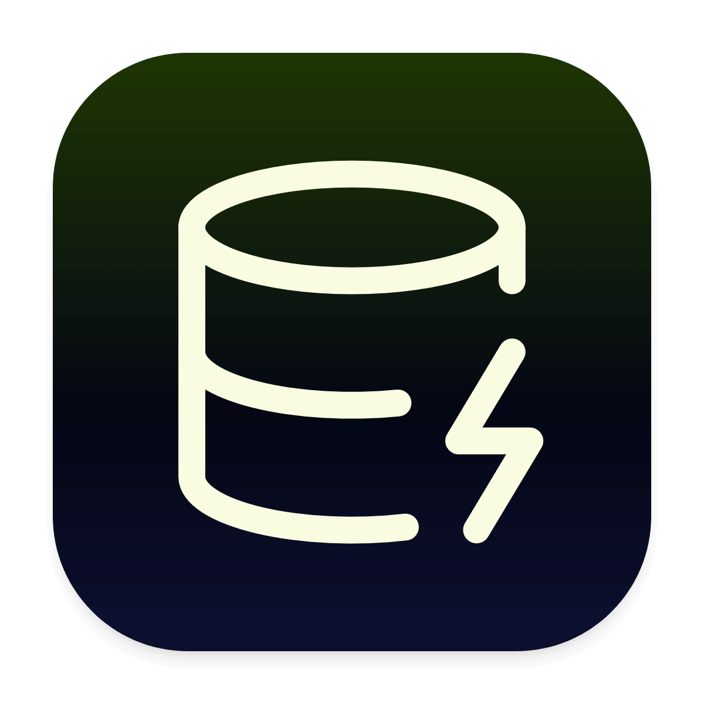

<div align="center">
  
  <h1>AI Optimizer</h1>
  <p><strong>Universal Token, Cost & Efficiency Engine for AI Coding Agents</strong></p>

  <p>
    <a href="https://github.com/airshell/ai-optimizer/releases/latest"></a>
    <a href="https://github.com/airshell/ai-optimizer/blob/main/LICENSE"></a>
    
    
  </p>
</div>

---

## Overview

**AI Optimizer** is an autonomous token accounting, cost auditing, and code efficiency engine designed to cut AI coding agent token waste and API costs by **30% to 53%** with zero loss of solution quality.

It couples **cross-agent optimization skills** (enforcing surgical diffs, stdlib-first solutions, and prompt cache reuse) with a **native macOS Menu Bar companion** delivering live, real-time token spend, velocity, and savings telemetry directly from your filesystem.

---

## Key Features

- **Native macOS Menu Bar Companion**: Ultra-lightweight status bar telemetry displaying live intensity (lite, full, ultra), active agent state, and token savings in an Obsidian dark popover dashboard.
- **Multi-Agent Unified Accounting**: Native transcript parsers for:
  - **Google Antigravity (`agy` & Antigravity IDE)**
  - **OpenAI Codex** (CLI & IDE extension)
  - **Anthropic Claude Code**
  - **RTK Proxy & Ponytail**
  - **OpenCode, Gemini CLI, Cursor, Windsurf & Cline**
- **Truth-First Deduplication**: Canonical summary event parsing (`token_usage_record`) with turn-by-turn fallback prevents artificial double-counting of prompt tokens.
- **100% Local & Private**: Runs entirely offline on your local machine. No external telemetry, no remote analytics, no data leakage.
- **Ultra-Low Overhead**: Native Swift frontend + high-performance in-memory aggregation cache delivers `< 2ms` dashboard response times with negligible battery impact.

---

## 1-Click Desktop Installation

### Option 1: Quick Install via Terminal (Recommended)

Run the following command to automatically download, install, and clear macOS Gatekeeper quarantine for the native Menu Bar app:

```bash
curl -fsSL https://raw.githubusercontent.com/airshell/ai-optimizer/main/install.sh | bash
```

### Option 2: Direct Download

Download the disk image directly from our GitHub Releases:

[Download AI Optimizer for macOS (.dmg)](https://github.com/airshell/ai-optimizer/releases/latest/download/AI-Optimizer-macOS.dmg)

*Drag `AiOptimizer.app` to your `/Applications` folder, then launch it from Spotlight.*

> **macOS Note:** If opening an ad-hoc signed release, run `xattr -cr /Applications/AiOptimizer.app` to clear the Gatekeeper quarantine attribute.

---

## How to Use the Open-Source Agent Skills

The open-source optimization skill is located at [`skills/ai-optimizer/SKILL.md`](skills/ai-optimizer/SKILL.md). It provides autonomous instructions that instruct coding assistants to produce minimal, high-leverage code and maximize prompt caching.

### 1. Install for Google Antigravity IDE / CLI
Symlink or copy the skill into your local agent skills directory:
```bash
mkdir -p ~/.gemini/config/skills
cp -R skills/ai-optimizer ~/.gemini/config/skills/
```

### 2. Install for Claude Code
```bash
mkdir -p ~/.claude/skills
cp -R skills/ai-optimizer ~/.claude/skills/
```

### 3. Install for Cursor / Windsurf / Codex
Add a reference to [`skills/ai-optimizer/SKILL.md`](skills/ai-optimizer/SKILL.md) in your workspace rules (`.cursorrules` or `AGENTS.md`):
```markdown
# AI Optimizer Rule
Adopt the AI Optimizer full tier: enforce YAGNI architecture, surgical diffs, stdlib-first solutions, and prompt-cache friendly turn handoffs.
```

### Optimization Intensity Tiers

| Level | Token Reduction | Behavior |
| :--- | :--- | :--- |
| **`lite`** | ~20% – 30% | Cuts conversational filler, pleasantries, and unsolicited summaries while keeping standard code structures. |
| **`full` (Default)** | ~35% – 50% | Strict YAGNI, standard library first, surgical non-contiguous diffs, and compressed agent-to-agent context handoffs. |
| **`ultra`** | ~50% – 65%+ | Maximum token compression: one-line explanations, pure code diffs, zero speculative abstractions, minimal AST expansion. |

---

## Coming Soon: AI Optimizer Enterprise (Server CLI)

We are launching the **AI Optimizer Enterprise Server Edition**, tailored for engineering organizations and cloud infrastructure:

- **CI/CD Token Quotas**: Block runaway agent loops in automated pull request review pipelines.
- **Headless Server Telemetry**: Deploy as a daemon in dev containers, ephemeral cloud environments, and Kubernetes developer pods.
- **Fleet-Wide Cost Auditing**: Aggregate agent spend across engineering teams with centralized budgeting and rate-card alerts.
- **Enterprise SLA & Support**: Custom model adapters, private pricing overrides, and compliance integration.

For enterprise inquiries, private pilots, or volume licensing:  
Contact: **enterprise@airshell.dev** or visit **[github.com/airshell](https://github.com/airshell)**.

---

## Open-Source License & Attribution

- The agent skill definitions (`skills/`) and installer scripts (`install.sh`) are licensed under the **[Apache License 2.0](LICENSE)**.
- Developed with precision by **[Airshell](https://github.com/airshell)**.
