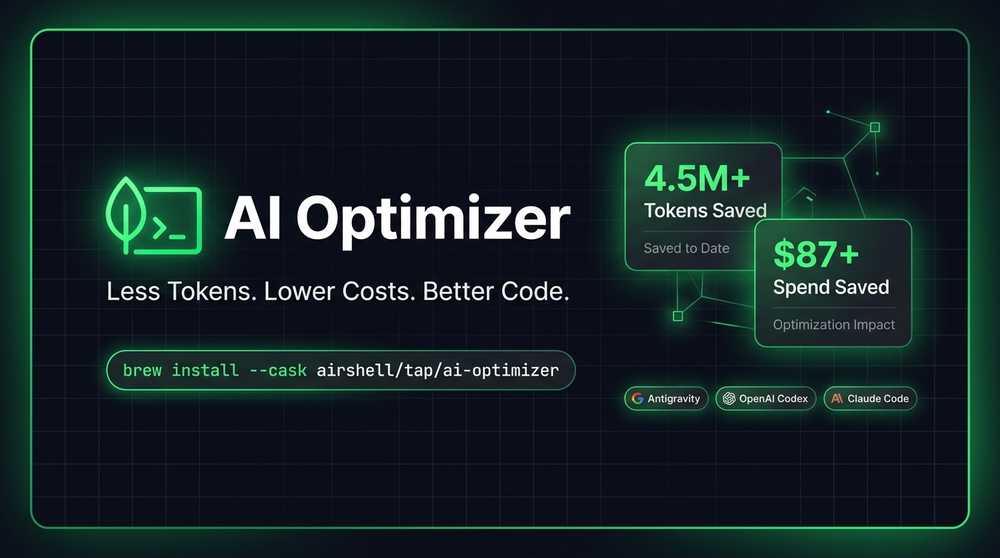
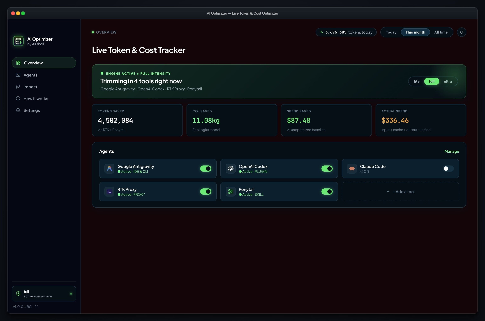
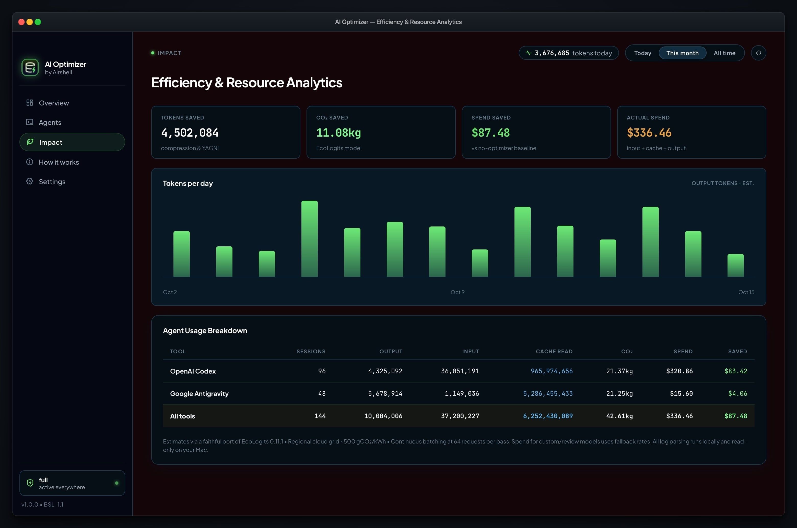

<div align="center">
  <a href="https://optimizer.aimaxo.com">
    
  </a>
  <br />
  <br />

  <p>
    <a href="https://optimizer.aimaxo.com"></a>
    <a href="https://github.com/airshell/ai-optimizer/releases/latest"></a>
    <a href="https://github.com/airshell/homebrew-tap"></a>
    <a href="LICENSE"></a>
    
    
  </p>
</div>

---

## Overview

**AI Optimizer** is a cross-platform auditing and optimization tool for AI coding agents that helps developers track token usage, analyze costs, measure real savings, and improve code quality.

By combining real-time token and cost auditing with software engineering best practices (strict YAGNI, surgical diffs, stdlib-first solutions, and prompt-cache maximization), AI Optimizer helps coding agents generate cleaner, more maintainable, and more efficient code while slashing token waste and LLM API costs by **30% to 53%**.

> *Optimize your AI workflows. Reduce unnecessary token consumption. Cut costs. Write better code.*

🌐 **Official Website:** [optimizer.aimaxo.com](https://optimizer.aimaxo.com)

> [!IMPORTANT]
> **🔒 100% Offline & Private by Design**  
> AI Optimizer runs entirely on your local machine. Every token count, usage metric, and dollar estimate is read directly from your local filesystem logs (`~/.gemini`, `~/.codex`, `~/.claude`). **Zero network calls, zero remote servers, zero external data tracking, and zero code or prompts ever leave your computer.**

---

## 🎯 The Goal

AI Optimizer aims to make AI-assisted software development not just more powerful, but also more **economical, private, and engineering-focused** — helping developers get better results from their AI coding assistants without wasting tokens or compromising code quality.

---

## ✨ Key Features

- **📊 Token Usage Auditing** — Track and analyze real token consumption (input, output, and cache reads) across supported AI coding agents.
- **💰 Real-Time Cost Analysis** — Understand AI usage costs per model and identify opportunities to reduce spending.
- **⚡ Savings Insights** — Discover and verify token and cost savings achieved through context compression, prompt caching, and surgical diffs.
- **🛠️ Code Quality Optimization** — Encourage cleaner, more maintainable code using established software development best practices (stdlib-first, modular design, zero speculative abstractions).
- **📝 Token-Efficient Code Generation** — Cut conversational filler, duplication, and inefficient implementation patterns so coding agents achieve more with fewer tokens.
- **🖥️ Native macOS Menu Bar Companion** — Ultra-lightweight status bar monitor displaying live intensity (`lite`, `full`, `ultra`), active agent status, and token velocity in a sleek Obsidian dark popover dashboard.
- **🛡️ Truth-First Deduplication** — Canonical summary event parsing (`token_usage_record`) with turn-by-turn fallback prevents artificial double-counting of prompt tokens.
- **🔒 100% Local & Private** — Runs entirely offline on your local machine. Zero external network connections, zero cloud analytics, zero data leakage.

---

## 📸 Visual Tour & Dashboard Walkthrough

### 1. Live Overview & Control Hub


The **Live Overview** serves as your central command deck for real-time AI usage and optimization:
- **Live Intensity Switcher:** One-click toggles between `lite`, `full`, and `ultra` optimization tiers to adapt token compression depth dynamically across your active projects.
- **Real-Time Savings Counters:** High-visibility metrics track cumulative tokens saved, carbon emissions avoided (via EcoLogits models), and net dollar savings calculated against standard un-optimized baseline usage.
- **Spend Summary:** Transparent breakdown comparing actual net spend vs. calculated baseline spend across your models.
- **Active Agent Monitor:** Automatic filesystem discovery for installed tools (Google Antigravity, OpenAI Codex, Claude Code, RTK Proxy, and more) with per-agent toggle switches to activate or pause optimization on the fly.
- **Instant Period Filtering:** Switch effortlessly between `Today`, `This month`, and `All time` to inspect short-term velocity or lifetime impact.

---

### 2. Efficiency & Resource Analytics


The **Efficiency & Resource Analytics** screen gives you deep, transparent visibility into your model usage and token economics:
- **Daily Token Velocity Chart:** Visual histogram of day-by-day output token volume over the selected billing cycle, helping you identify usage spikes and model workload trends.
- **Per-Agent Breakdown Ledger:** Multi-column accounting table showing exact session counts, output tokens, input prompt tokens, and cache-read tokens for each installed AI assistant.
- **Prompt Cache Efficiency:** Dedicated accounting for cache-read tokens, verifying cost reductions achieved through high cache-hit rates.
- **Environmental & Financial ROI:** Accurate carbon impact calculations and dollar savings per tool derived directly from official model rate cards.
- **100% Local Proof:** Every figure is computed directly from your local filesystem logs (`~/.gemini`, `~/.codex`, `~/.claude`) without sending data or prompts over the internet.


---

## 💻 Installation & Updates

### Option 1: Install via Homebrew (Recommended)

Install the native macOS Menu Bar app in one command using the official Airshell tap:

```bash
brew install --cask airshell/tap/ai-optimizer
```

To update to future releases:
```bash
brew upgrade --cask ai-optimizer
```

---

### Option 2: 1-Line Terminal Script

Run the automated installer script to download the disk image and clear Gatekeeper:

```bash
curl -fsSL https://raw.githubusercontent.com/airshell/ai-optimizer/main/install.sh | bash
```

---

### Option 3: Direct Download (.dmg)

Download the disk image directly from our GitHub Releases:

👉 **[Download AI Optimizer for macOS (.dmg)](https://github.com/airshell/ai-optimizer/releases/latest/download/AI-Optimizer-macOS.dmg)**

*Drag `AiOptimizer.app` to your `/Applications` folder, then launch it from Spotlight.*

> **macOS Note:** If opening an ad-hoc signed release, run `xattr -cr /Applications/AiOptimizer.app` to clear the Gatekeeper quarantine attribute.

---

## 🤖 Supported Agents & Unified Multi-Agent Accounting

AI Optimizer provides native, zero-mock filesystem and transcript parsers for:

- **Google Antigravity (`agy` & Antigravity IDE)**
- **OpenAI Codex** (CLI & IDE extension)
- **Anthropic Claude Code**
- **RTK Proxy & Ponytail**
- **OpenCode, Gemini CLI, Cursor, Windsurf & Cline**

---

## 🧠 How to Use the Open-Source Agent Skills

The open-source optimization skill is located at [`skills/ai-optimizer/SKILL.md`](skills/ai-optimizer/SKILL.md). It provides autonomous instructions that instruct coding assistants to produce minimal, high-leverage code and maximize prompt caching.

### 1. Install for Google Antigravity IDE / CLI
Symlink or copy the skill into your local agent skills directory:
```bash
mkdir -p ~/.gemini/config/skills
cp -R skills/ai-optimizer ~/.gemini/config/skills/
```

### 2. Install for Claude Code
```bash
mkdir -p ~/.claude/skills
cp -R skills/ai-optimizer ~/.claude/skills/
```

### 3. Install for Cursor / Windsurf / Codex
Add a reference to [`skills/ai-optimizer/SKILL.md`](skills/ai-optimizer/SKILL.md) in your workspace rules (`.cursorrules` or `AGENTS.md`):
```markdown
# AI Optimizer Rule
Adopt the AI Optimizer full tier: enforce YAGNI architecture, surgical diffs, stdlib-first solutions, and prompt-cache friendly turn handoffs.
```

### Optimization Intensity Tiers

| Level | Token Reduction | Behavior |
| :--- | :--- | :--- |
| **`lite`** | ~20% – 30% | Cuts conversational filler, pleasantries, and unsolicited summaries while keeping standard code structures. |
| **`full` (Default)** | ~35% – 50% | Strict YAGNI, standard library first, surgical non-contiguous diffs, and compressed agent-to-agent context handoffs. |
| **`ultra`** | ~50% – 65%+ | Maximum token compression: one-line explanations, pure code diffs, zero speculative abstractions, minimal AST expansion. |

---

---

## 🌟 Recommended Companion Skills for Maximum Token & Cost Savings

To help you get the most out of AI Optimizer, we have curated and battle-tested the most impactful companion skills designed to eliminate token waste:

| Skill | Primary Benefit | Why It Saves Tokens & Money |
| :--- | :--- | :--- |
| [`context-budget`](skills/context-budget) | **Context Window Auditor** | Scans active rules, skills, MCP servers, and prompt files to identify context bloat and reclaim valuable token headroom. |
| [`token-budget-advisor`](skills/token-budget-advisor) | **Upfront Depth Controller** | Classifies request complexity and gives you control over response verbosity before the agent starts generating code. |
| [`prompt-optimizer`](skills/prompt-optimizer) | **Prompt Compactor** | Refines raw prompts into surgical, high-signal instructions that maximize prompt-cache hit rates (up to 90%+). |
| [`regex-vs-llm`](skills/regex-vs-llm) | **Zero-Token Text Extractor** | Uses fast, deterministic regular expressions for 95%+ of structured text tasks, saving LLM calls strictly for edge cases. |
| [`cost-tracking`](skills/cost-tracking) | **Session Spend Breakdown** | Provides granular per-session cost and model accounting from local session logs without external API dependencies. |
| [`opt-review`](skills/opt-review) | **Diff & Bloat Pruner** | Inspects code diffs specifically for what can be deleted (speculative code, single-caller abstractions, comment clutter) before merging. |
| [`opt-compress`](skills/opt-compress) | **Rule & Instruction Compactor** | Rewrites project instructions and AGENTS.md files into high-signal declarative bullets, saving input tokens on every turn. |
| [`opt-loop`](skills/opt-loop) | **Loop & Cron Budget Control** | Enforces prompt-cache pacing (<270s or ≥1200s, avoiding the 300s dead zone), event triggers, and hard exit stops for recurring tasks. |
| [`opt-design`](skills/opt-design) | **Lean UI Engineering** | Delivers pixel-perfect HTML/CSS with ~50% fewer code tokens via fluid units and modern CSS custom properties without div-soup bloat. |
| [`opt-memory`](skills/opt-memory) | **Committed Architecture Cache** | Maintains a single version-controlled PROJECT.md caching architecture intent and build commands to eliminate cold-start rediscovery. |
| [`opt-debt`](skills/opt-debt) | **YAGNI Shortcut Ledger** | Scans for deliberate YAGNI comments (shortcut:, opt:) and compiles an actionable debt ledger with revisit triggers. |

---

## 🚀 Coming Soon: AI Optimizer Enterprise (Server CLI)

We are launching the **AI Optimizer Enterprise Server Edition**, tailored for engineering organizations and cloud infrastructure:

- **CI/CD Token Quotas**: Block runaway agent loops in automated pull request review pipelines.
- **Headless Server Monitoring**: Deploy as a lightweight background daemon in dev containers, ephemeral cloud environments, and Kubernetes developer pods.
- **Fleet-Wide Cost Auditing**: Aggregate agent spend across engineering teams with centralized budgeting and rate-card alerts.
- **Enterprise SLA & Support**: Custom model adapters, private pricing overrides, and compliance integration.

---

## 📜 Licensing & Terms of Use

This repository uses a **Mixed Licensing Model** ([LICENSE](LICENSE)):

### 1. Open Source Components (MIT License)
- The agent skill definitions (`skills/`) and installer scripts (`install.sh`) are licensed under the **[MIT License](LICENSE)**.
- Free to use, adapt, and integrate into any personal or open-source workflow.

### 2. Application & Core Engine (Business Source License 1.1)
- The **AI Optimizer Application**, binary packages, desktop companions, and core optimization engine are licensed under the **[Business Source License 1.1 (BSL-1.1)](LICENSE)** (converting to GNU AGPLv3 after 4 years).
- **Personal Use:** Free for personal, non-commercial use, provided you do not use it to build, distribute, or operate a competing product or commercial hosted service.
- **Commercial & Enterprise Use:** Any commercial use by enterprises, companies, or organizations (including deployment across employee developer fleets or server-side CI/CD runners) requires a commercial license agreement from Licensor.

For enterprise licensing arrangements, custom use grants, or cloud integrations:  
📧 Contact: **info@aimaxo.com** or visit **[optimizer.aimaxo.com](https://optimizer.aimaxo.com)**.

---

Developed with precision by **[Airshell](https://github.com/airshell)** • Official Website: **[optimizer.aimaxo.com](https://optimizer.aimaxo.com)**.
