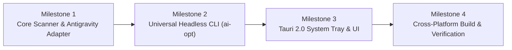

# AI Optimizer (Cross-Platform) — Technical Implementation Plan

## Executive Overview

**AI Optimizer** is an open-source, cross-platform token tracker, cost auditor, and efficiency monitor for AI coding agents. It provides:
1. **A Headless CLI (`ai-opt`)** that works across macOS, Windows, and Linux.
2. **A Native Desktop Tray Companion** using **Tauri 2.0** that renders in the **macOS Menu Bar** and the **Windows System Tray**, providing a dark-mode popover dashboard.
3. **Unified Multi-Agent Tracking**: Native real-time accounting for **Google Antigravity (`agy` & IDE)**, **OpenAI Codex (CLI & IDE Extension)**, **Anthropic Claude Code**, **OpenCode**, and savings generated by **RTK Proxy** and **Ponytail**.

---

## 1. System Architecture

```mermaid
flowchart TD
    subgraph Data Sources ["Local Agent Data (Cross-Platform)"]
        AG["Antigravity (~/.gemini/antigravity/brain)"]
        CX["Codex (~/.codex/sessions)"]
        CC["Claude Code (~/.claude/projects)"]
        RTK["RTK Proxy (rtk gain / app data)"]
    end

    subgraph Core Engine ["@ai-optimizer/core (TypeScript)"]
        Scanner["Multi-Agent Log Scanner"]
        Watcher["Cross-Platform File Watcher (FSEvents / ReadDirChanges)"]
        Pricing["Pricing & Model Registry (Gemini, OpenAI, Anthropic)"]
        EcoLogits["Carbon & EcoLogits Engine"]
        
        Scanner --> Pricing
        Scanner --> EcoLogits
        Watcher --> Scanner
    end

    AG --> Scanner
    CX --> Scanner
    CC --> Scanner
    RTK --> Scanner

    subgraph Interfaces ["Distribution & Presentation Layer"]
        CLI["Headless CLI (ai-opt)\n• Terminal Tables\n• JSON Output\n• CI/CD Scripting"]
        Tauri["Tauri 2.0 Desktop Wrapper\n• macOS: Top MenuBarExtra\n• Windows: Taskbar SystemTray\n• Dark Popover Dashboard"]
    end

    Core Engine --> CLI
    Core Engine --> Tauri
```

---

## 2. Directory & Package Structure

We will structure the project as a clean, lightweight monorepo:

```text
ai-optimizer/
├── packages/
│   ├── core/                          # Cross-platform scanner & analytics engine
│   │   ├── src/
│   │   │   ├── adapters/
│   │   │   │   ├── antigravity.ts     # Antigravity IDE & agy transcript parser
│   │   │   │   ├── codex.ts           # Codex sessions & turn usage parser
│   │   │   │   ├── claude.ts          # Claude Code projects parser
│   │   │   │   ├── rtk.ts             # RTK Proxy savings extractor
│   │   │   │   └── ponytail.ts        # Ponytail YAGNI reduction calculator
│   │   │   ├── pricing/
│   │   │   │   ├── models.json        # Unified rates (Gemini, GPT-6, Claude)
│   │   │   │   └── calculator.ts      # Input, Output, and Cache cost math
│   │   │   ├── eco/
│   │   │   │   ├── ecologits.ts       # CO2 calculation by cloud provider
│   │   │   │   └── grids.json         # Regional carbon emission factors
│   │   │   ├── watcher.ts             # Live file monitoring
│   │   │   └── index.ts
│   │   ├── package.json
│   │   └── tsconfig.json
│   │
│   ├── cli/                           # Standalone headless executable
│   │   ├── bin/
│   │   │   └── ai-opt.ts              # CLI commands: --today, --daily, --json
│   │   ├── src/
│   │   │   └── formatters/            # Unicode tables, compact ASCII for Windows
│   │   └── package.json
│   │
│   └── desktop/                       # Tauri 2.0 Menu Bar & System Tray App
│       ├── src-tauri/                 # Rust Native Layer
│       │   ├── src/
│       │   │   ├── main.rs            # TrayIcon setup & window lifecycle
│       │   │   └── tray.rs            # MenuBar (Mac) & Taskbar (Win) handlers
│       │   ├── Cargo.toml
│       │   └── tauri.conf.json
│       └── ui/                        # High-Performance Webview Dashboard
│           ├── src/
│           │   ├── components/        # GaugeCards, ModelTable, SavingsBadge
│           │   ├── App.tsx
│           │   └── styles.css         # Dark theme (Obsidian & Electric Green)
│           └── index.html
```

---

## 3. Core Engine Specification

### 3.1. Cross-Platform Path Normalizer
All path lookups resolve via `os.homedir()`:
```typescript
export function getAgentPaths() {
  const home = os.homedir();
  return {
    antigravityBrain: path.join(home, ".gemini", "antigravity", "brain"),
    antigravityIde: path.join(home, ".gemini", "antigravity-ide", "conversations"),
    codexSessions: process.env.CODEX_HOME || path.join(home, ".codex", "sessions"),
    claudeProjects: process.env.CLAUDE_CONFIG_DIR || path.join(home, ".claude", "projects"),
    rtkData: process.platform === "win32"
      ? path.join(process.env.APPDATA || path.join(home, "AppData", "Roaming"), "rtk")
      : path.join(home, "Library", "Application Support", "rtk"),
  };
}
```

### 3.2. Antigravity Adapter (`antigravity.ts`)
* **Log files scanned:** `brain/<id>/.system_generated/logs/transcript.jsonl`.
* **Turn breakdown:**
  * **Input Tokens:** Length of `USER_INPUT` steps + `GENERIC` tool execution outputs.
  * **Output Tokens:** Length of `PLANNER_RESPONSE` (`content` + `thinking` + `tool_calls`).
* **Model Detection:** Reads settings changes or metadata tags (e.g. `Gemini 3.8 Flash`, `Gemini 1.5 Pro`).

### 3.3. Codex Adapter (`codex.ts`)
* **Log files scanned:** `sessions/YYYY/MM/DD/rollout-*.jsonl`.
* **Turn breakdown:** Reads `token_usage_record` and `event_msg (token_count)`:
  * `input_tokens` (adjusted for cached reads)
  * `cached_input_tokens` (billed at 10% rate)
  * `output_tokens` & `reasoning_output_tokens`
* **Real-time reliability:** Watches file modification times so Codex extension runs inside Antigravity IDE are captured as soon as turns finish.

### 3.4. RTK Proxy & Ponytail Savings Adapter
* **RTK Savings:** Queries `rtk gain --json` or parses local `rtk` stats to show terminal tokens prevented from entering agent context.
* **Ponytail Savings:** Measures the reduction ratio between unconstrained baselines and Ponytail's minimal diff output.

---

## 4. UI/UX Design (Tauri 2.0 Popover)

### Visual Style
* **Theme:** Deep obsidian background (`#0D0D0E`), subtle border separation (`#1E1E22`), electric lime accent (`#10B981`) for savings, and clean monochrome indicators.
* **Typography:** `GeistMono` for numbers and token counts; system sans-serif for UI labels.

### Layout Wireframe
```text
┌────────────────────────────────────────────────────────┐
│  ⚡ AI OPTIMIZER                   [24h] [7d] [All]    │
├────────────────────────────────────────────────────────┤
│  TODAY'S TOTAL                   ESTIMATED COST        │
│  3,588,777 tokens                $27.76 USD            │
│  79.8M cached                    2.21 kg CO₂           │
├────────────────────────────────────────────────────────┤
│  ACTIVE AGENTS                                         │
│  • Antigravity (Gemini 3.8)      320k tok   $0.06      │
│  • Codex (GPT-6.1-sol)          2.66M tok  $25.21      │
│  • Codex (auto-review)           509k tok   $2.47      │
├────────────────────────────────────────────────────────┤
│  SAVINGS (RTK + PONYTAIL)                              │
│  🌿 1.42M tokens shaved (~$11.80 saved today)          │
├────────────────────────────────────────────────────────┤
│  [Open Detailed Dashboard]              [Quit]         │
└────────────────────────────────────────────────────────┘
```

---

## 5. Implementation Milestones



| Milestone | Deliverables | Verification Criteria |
| :--- | :--- | :--- |
| **Milestone 1: Core Engine** | Build base engine, implement `antigravity.ts`, `rtk.ts`, and updated `models.json`. | Unit tests passing against local Antigravity transcripts and Codex rollout logs. |
| **Milestone 2: Headless CLI** | Build `packages/cli` with flags `--today`, `--daily`, `--json`, `--client`. Symlink to PATH. | Running `ai-opt --today` outputs combined Antigravity + Codex + Claude table. |
| **Milestone 3: Tauri Tray App** | Scaffold Tauri 2.0 project with `tray-icon` plugin. Implement Dark Popover Webview. | Menu bar icon shows live token counter; clicking displays popover. |
| **Milestone 4: Packaging** | Build macOS `.dmg`/`.app` and Windows portable `.exe`. Test on macOS and Windows. | Zero permissions errors on fresh install; auto-launches on login. |

---

## 6. Verification & Safety Guidelines

1. **Gatekeeper & Security Compliance:**
   * The desktop app will be built locally, completely avoiding closed-source signature locks that caused issues with proprietary desktop binaries.
2. **Read-Only Operations:**
   * The scanner runs purely in read-only mode against agent logs; it will never write to or modify `~/.gemini` or `~/.codex` session databases.
3. **Resource Efficiency:**
   * Event debouncing (500ms) on filesystem events to ensure near-zero CPU and memory overhead during long coding sessions.
